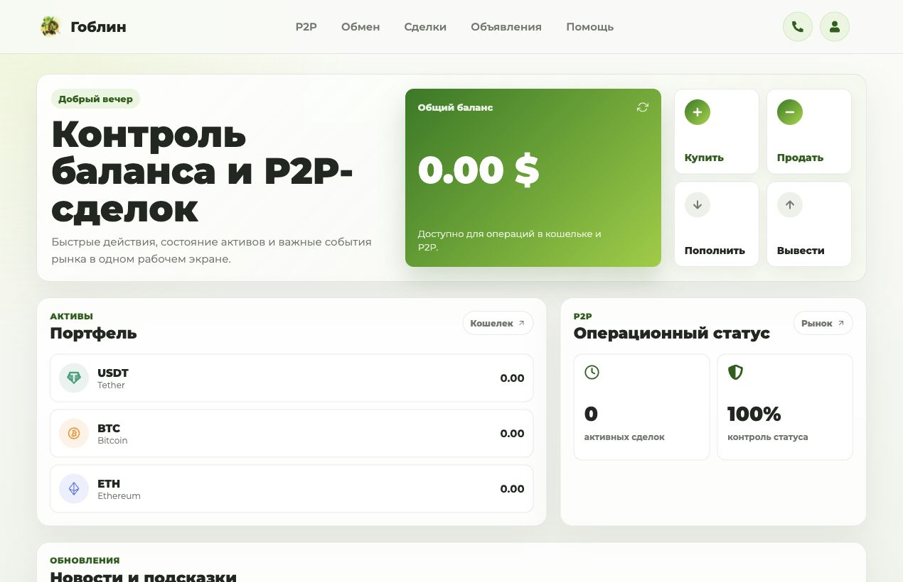
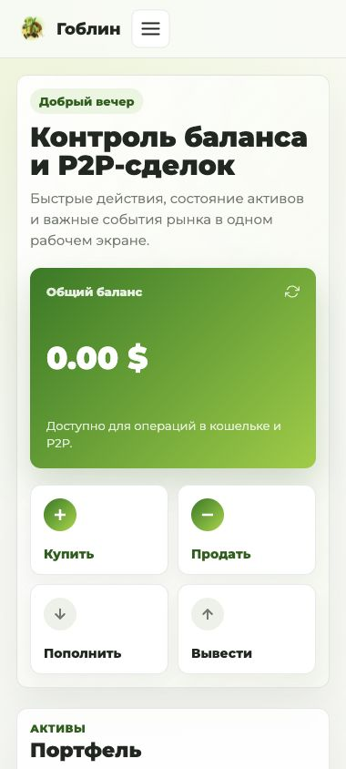

<div align="center">
  

  <h1>Goblin</h1>

  <p><strong>Криптокошелёк, P2P-платформа и торговый терминал в одном интерфейсе.</strong></p>

  <p>
    
    
    
    
  </p>
</div>

## О проекте

Goblin — авторский full-stack проект финансовой платформы с адаптивным интерфейсом. В одном продукте объединены управление криптоактивами, P2P-сделки, спотовая и фьючерсная торговля, платёжный процессинг и маркетплейс цифровых подарков.

Проект опубликован как портфолио-кейс: репозиторий предназначен для знакомства с интерфейсом, архитектурой и реализацией продукта.

## Возможности

- **Кошелёк:** кастодиальные адреса для USDT, TRON, Solana, BTC и ETH; депозиты зачисляются только по подтверждённой транзакции в блокчейне после AML-проверки; вывод и сбор средств в казначейство.
- **P2P:** объявления, ордера, эскроу, комиссии, чат сделки и поддержка в реальном времени.
- **Торговля:** терминал SPOT и FUTURES, лимитные и рыночные ордера, стакан, график, позиции и история исполнений.
- **Обмен и TRON-свопы**, запуск токенов на Solana (pump).
- **Процессинг** платежей и **маркетплейс** цифровых товаров и услуг (отдельное Next.js-приложение).
- **NFT-подарки**, новости, реферальная программа, бонусы на комиссии.
- **Админ-панель:** права сотрудников, журналы входов и действий, переключатели функций, модерация маркета.
- **Android-приложение** на Capacitor.

## Интерфейс

<table>
  <tr>
    <td width="70%" valign="top">
      
    </td>
    <td width="30%" valign="top">
      
    </td>
  </tr>
</table>

## Технологии

| Слой | Технологии |
| --- | --- |
| Веб-клиент | React 19, React Router, Vite, SCSS Modules, Tailwind CSS |
| Маркет | Next.js 16, TypeScript, Zod |
| Мобильное приложение | Capacitor (Android) |
| Backend | Node.js, Express, Socket.IO |
| Данные | MySQL, SQL-миграции 001–036, `decimal.js` для денежных расчётов |
| Блокчейн | `ethers`, `bitcoinjs-lib`, `tronweb`, `@solana/web3.js` |
| Авторизация | JWT с отзывом через `token_version`, `bcryptjs`, роли и права сотрудников |
| Интеграции | рыночные данные Binance/Bybit, AML-проверка депозитов, Jupiter, TronGrid, Resend |

## Архитектура

```text
src/                     веб-клиент (React)
├── Components/          переиспользуемые компоненты
├── Pages/               разделы: кошелёк, P2P, торговля, процессинг, маркет, админка
└── utils/               общие утилиты
apps/market/             маркетплейс (Next.js)
android/                 Android-оболочка (Capacitor)
backend/
├── src/routes/          HTTP API
├── src/services/        бизнес-логика: торговля, P2P, процессинг, казначейство, сети
├── src/middleware/      авторизация, rate limit, доступ к функциям
├── sql/                 миграции MySQL
├── scripts/             миграции, обслуживание кошельков, проверки релиза
└── test/                серверные тесты
docs/                    дизайн-решения, интеграции, заметки к релизам
scripts/                 браузерные QA-проверки интерфейса
```

## Качество и безопасность

- **CI** на каждый PR: 101 тест бэкенда (`node:test`), сборка веб-клиента, линтер, проверка типов и сборка маркета.
- Секрет подписи JWT обязателен: без `JWT_SECRET` сервер не стартует вне явного `development`/`test`.
- Ручное начисление баланса запрещено, депозиты учитываются только по подтверждённым транзакциям; деньги считаются через `decimal.js`.
- Мастер-мнемоника и ключ шифрования кошельков живут только в окружении сервера; Android-приложение ключей не содержит.
- Rate limit, журнал входов по IP и устройствам, отзыв сессий, права сотрудников на отдельные действия.

## Запуск

Нужны Node.js 22 и MySQL.

```bash
cp backend/.env.example backend/.env    # JWT_SECRET, доступ к MySQL, ключи кошельков
npm --prefix backend ci
npm --prefix backend run migrate
npm --prefix backend start              # API

npm ci && npm run dev                   # веб-клиент
npm --prefix apps/market ci && npm --prefix apps/market run dev   # маркет
```

Проверки как в CI: `npm --prefix backend test`, `npm run build`, `npm --prefix apps/market run lint`.
Сборка Android описана в [android/README.md](android/README.md).

## Статус

Проект работает в продакшене на [cryptogoblin.ru](https://cryptogoblin.ru) и продолжает развиваться. Заметки к выпускам и решения по интерфейсу и интеграциям — в [docs/](docs/).

---

<div align="center">
  <sub>Авторский проект. Исходный код опубликован для просмотра.</sub>
</div>
